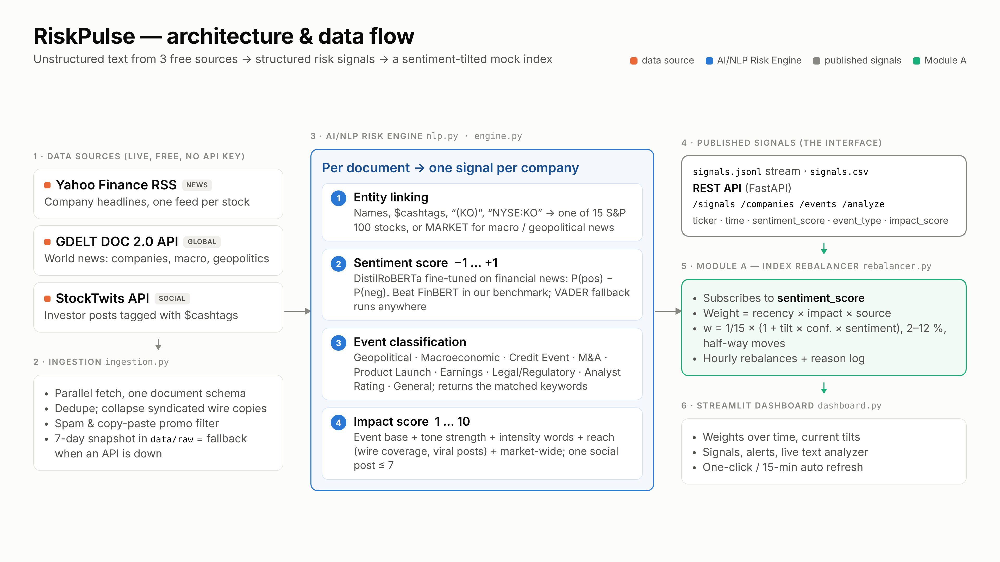
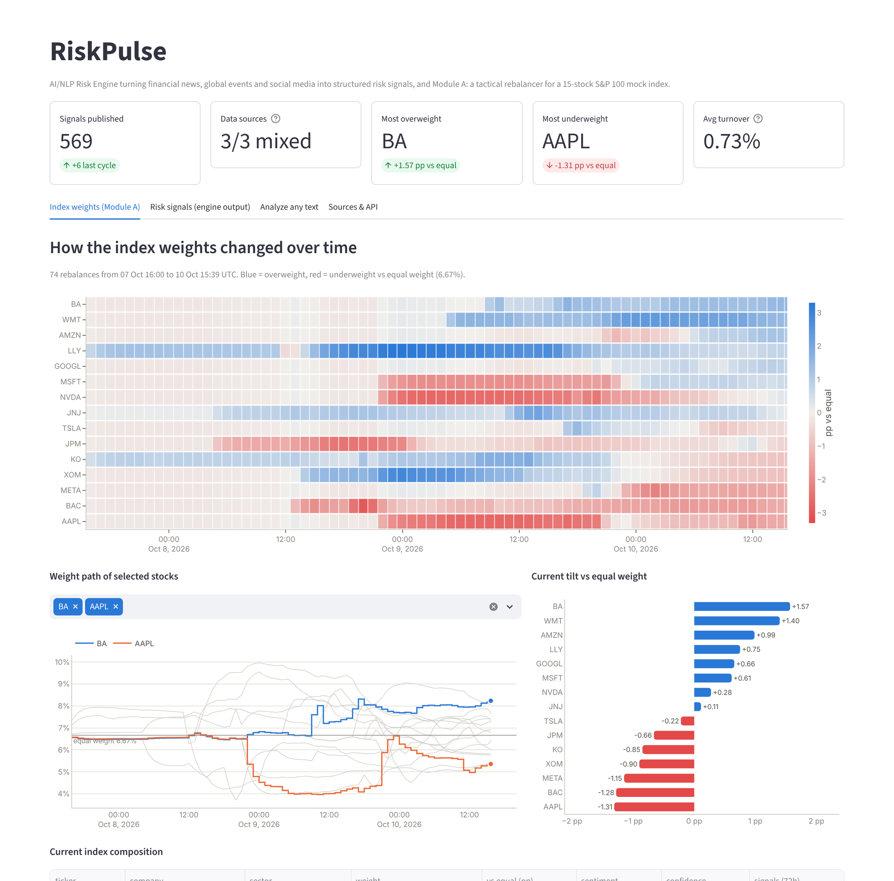

# RiskPulse: AI/NLP Risk Engine & Tactical Index Rebalancer - S&P Global & Crisil Campus Hackathon

**Candidate Name:** Rahitya Donthi

**College Email ID:** mm24b004@smail.iitm.ac.in

**College / Campus:** Indian Institute of Technology Madras

**Demo Video Link:** cd $HOME\iitm-rahitya-donthi-hackathon
notepad README.md
**Slide Deck Link (if hosted externally):** Not hosted externally. The deck is in this repo: [`docs/presentation.pdf`](docs/presentation.pdf)

---

## 1. Project Overview / Problem Statement & Approach

Markets move on text long before it shows up in a spreadsheet: a credit warning from a bank CEO, a new tariff, a
product launch, a wave of bearish posts. Analysts cannot read thousands of headlines and posts a day, and a static
index cannot react to them. The case study asks for a platform that ingests this unstructured, real-time text, turns
it into **structured, machine-readable risk signals**, and puts those signals to work in a downstream module.

**RiskPulse** is that platform. Its **AI/NLP Risk Engine** pulls live text from **three free sources** (Yahoo Finance
news, the GDELT global news database and StockTwits social posts), links every document to the companies it names,
and outputs one signal per company with:

- a **Sentiment Score** from -1 to +1, from a transformer fine-tuned on financial news,
- an **Event Classification**: Geopolitical, Macroeconomic, Credit Event, Merger/Acquisition, Product Launch,
  Earnings, Legal/Regulatory, Analyst Rating or General,
- an **Impact Score** from 1 to 10.

Signals are published to an append-only stream (`data/signals.jsonl`, also as CSV) and through a **REST API**.

As the downstream application we built **Module A - Tactical Index Rebalancing**: a mock index of 15 S&P 100 stocks
that subscribes to the Sentiment Score and rebalances every hour and on every live engine cycle. Positive sentiment
raises a stock's weight and negative sentiment lowers it. Signals are weighted by recency, impact and source, thin
evidence is shrunk, position limits and turnover control keep the index investable, and every move is logged with
the headline that drove it. A **Streamlit dashboard** shows how the weights change over time and the signals behind
them, and lets anyone run the engine on their own text.

## 2. Architecture & Tech Stack



### Data flow

One engine cycle takes about 30 seconds; every step is a separate module in `src/`.

1. **Ingestion** (`ingestion.py`) fetches the three sources in parallel and normalises them to one document schema.
   It removes duplicates (syndicated wire copies are counted as *coverage*), filters social spam and copy-paste
   promotion campaigns, and merges everything into a rolling 7-day snapshot in `data/raw/`. If an API is down or
   rate-limited, the engine falls back to that snapshot automatically.
2. **NLP Risk Engine** (`nlp.py`, `engine.py`) processes every new document:
   - *entity linking*: company names, `$cashtags`, "(KO)" and "NYSE:KO" map to the 15 tickers; macro, geopolitical
     and credit news that names no company becomes a `MARKET` signal;
   - *sentiment*: `P(positive) - P(negative)` from DistilRoBERTa fine-tuned on financial news;
   - *event classification*: a weighted keyword taxonomy that also returns the keywords it matched;
   - *impact score*: a transparent severity model (event base + tone strength + intensity words + reach).
3. **Publish**: each signal is appended to `data/signals.jsonl`, the stream Module A subscribes to, and to
   `data/signals.csv`, and is served by the **REST API** (`api.py`).
4. **Module A** (`rebalancer.py`) consumes the stream and rebalances the mock index (method below).
5. **Dashboard** (`dashboard.py`) shows the published data and can trigger new engine cycles.

Example signal (real output, 10 Oct 2026):

```json
{
  "timestamp": "2026-10-10T12:35:00Z",
  "source": "yahoo_finance",
  "ticker": "JPM",
  "company": "JPMorgan Chase",
  "headline": "Jamie Dimon warns the next credit crisis could be severe — take these steps to protect your wallet now",
  "sentiment_score": -0.9612,
  "sentiment_label": "negative",
  "event_type": "Credit Event",
  "event_keywords": ["credit crisis"],
  "impact_score": 9,
  "model": "distilroberta-financial"
}
```

### Module A method

At each rebalance time *t*, using only signals published before *t* (no look-ahead):

| Step | Formula |
|---|---|
| Signal weight | `0.5^(age_hours / 24) x impact_score x source_weight` (news 1.0, social 0.6), last 72 h only |
| Stock sentiment | `S = sum(weight x sentiment_score) / sum(weight)` |
| Confidence (shrinkage) | `c = E / (E + 2)`, where `E` is the summed recency weight, so one stray post cannot move the index |
| Target weight | `1/15 x (1 + tilt x c x S)` with tilt = 1.0, clipped to 2-12 % and renormalised to 100 % |
| Turnover control | `new = old + 0.5 x (target - old)` |

### Tech stack

| Layer | Choice | Why |
|---|---|---|
| Language | Python 3.10+ | one language for data, ML, API and UI |
| Sentiment model | [`mrm8488/distilroberta-finetuned-financial-news-sentiment-analysis`](https://huggingface.co/mrm8488/distilroberta-finetuned-financial-news-sentiment-analysis) (Hugging Face, PyTorch) | beat `ProsusAI/finbert` on our benchmark (macro-F1 0.71 vs 0.66) and is ~1.9x faster on CPU |
| Fallback model | VADER + a 90-word finance lexicon | runs anywhere with no download (`RISKPULSE_MODEL=vader`) |
| Events and impact | rule-based taxonomy + transparent scoring | explainable (matched keywords are returned), needs no labeled training data |
| Data handling | pandas, requests, JSON-lines files | simple, inspectable, no database to install |
| API | FastAPI + Uvicorn | typed, validated endpoints with auto-generated docs at `/docs` |
| Dashboard | Streamlit + Plotly | interactive, colour-blind-safe palette, light and dark mode |
| Quality | pytest (24 tests), ruff (lint + Black-style formatting) | the pipeline is verified offline in seconds |

### REST API

Start it with `python src/main.py api`; interactive docs are at <http://localhost:8000/docs>.

| Endpoint | Returns |
|---|---|
| `GET /signals?ticker=&event_type=&source=&min_impact=&since=&limit=` | structured signals, newest first |
| `GET /companies`, `GET /companies/{ticker}` | per-company sentiment, top event, max impact, latest signals |
| `GET /events?min_impact=7` | high-impact events (a ready trigger feed for a stress-testing module) |
| `POST /analyze` with `{"text": "...", "source_type": "news"}` | runs the NLP engine on any text |
| `GET /index/weights`, `GET /index/history` | Module A output |
| `GET /health` | status and signal counts |

## 3. Dataset Used

All data is **public and free**: no API keys, no payment, no proprietary or client data. Everything used to run the
prototype is in `data/`.

| File | Contents | Source |
|---|---|---|
| `data/raw/yahoo_finance.json` | 223 company news headlines with RSS summaries | [Yahoo Finance RSS](https://feeds.finance.yahoo.com/rss/2.0/headline?s=AAPL&region=US&lang=en-US), one feed per ticker |
| `data/raw/gdelt.json` | 83 global news articles (companies, macro, geopolitics) | [GDELT DOC 2.0 API](https://blog.gdeltproject.org/gdelt-doc-2-0-api-debuts/), listed in the case study |
| `data/raw/stocktwits.json` | 347 social posts with `$cashtags`; 117 carry the author's own Bullish/Bearish tag | [StockTwits public API](https://api.stocktwits.com/api/2/streams/symbol/AAPL.json) |
| `data/signals.jsonl`, `data/signals.csv` | 569 structured risk signals (engine output) | produced by RiskPulse |
| `data/weights_history.csv`, `data/rebalance_log.csv` | index weights per rebalance, and every move with its driver | produced by Module A |
| `data/last_run.json`, `data/processed_doc_ids.txt` | status of the last cycle; documents already analysed | produced by RiskPulse |
| `data/eval/finance_tweets_valid.csv` | 2,388 finance tweets labeled Bearish / Bullish / Neutral | [zeroshot/twitter-financial-news-sentiment](https://huggingface.co/datasets/zeroshot/twitter-financial-news-sentiment) (MIT licence) |
| `data/eval/event_labels.csv` | 130 real headlines hand-labeled with an event type (70 dev, 60 held-out test) | sampled from the snapshot; the test split was labeled before the classifier was run on it |
| `data/eval/results.json` | benchmark results | `python src/main.py evaluate` |

The snapshot was collected live between **5 and 10 October 2026**. StockTwits returns the latest ~30 posts per stock,
so its history reaches back furthest. Every live run merges new documents into the snapshot, so it always holds the
exact data behind the published signals. Third-party text is kept for non-commercial, educational use; the rights
remain with the original publishers.

**Assumptions**

- The mock index holds 15 S&P 100 stocks across 7 sectors and starts at equal weight (6.67 % each). Prices and
  transaction costs are not modelled: the module's job is to show how sentiment drives the weights.
- A news item is attributed to a company only if the company is named in the **headline**; social posts use their
  explicit `$cashtags`. Macro, geopolitical and credit news that names no company becomes a `MARKET` signal.
- X/Twitter's API is paid, so StockTwits (a finance-focused social network) is the social source. GDELT allows about
  one request every 5 seconds, so all companies are batched into one query.
- Timestamps are publication times in UTC, and a rebalance at time *t* only uses signals published before *t*.

## 4. Quickstart & Installation

Runtime: **Python 3.10 or newer** (tested with Python 3.11, 3.12 and 3.13 on Linux). No GPU is needed.

Step-by-step commands to set up the environment and run the code locally:

```bash
git clone https://github.com/rahitya186/iitm-rahitya-donthi-hackathon.git
cd iitm-rahitya-donthi-hackathon
python -m venv .venv
source .venv/bin/activate           # Windows: .venv\Scripts\activate
pip install -r requirements.txt

python src/main.py run              # fetch the 3 live sources -> NLP risk signals -> rebalance the index
python src/main.py dashboard        # open http://localhost:8501
```

Optionally, in a second terminal (with the same `.venv` activated), start the REST API:

```bash
python src/main.py api              # open http://localhost:8000/docs
```

| Command | What it does |
|---|---|
| `python src/main.py run` | one live engine cycle: fetch, analyse, publish signals, rebalance |
| `python src/main.py run --loop 15` | keep running every 15 minutes (real-time mode) |
| `python src/main.py run --offline` | replay the saved snapshot in `data/raw` (no internet needed) |
| `python src/main.py run --offline --reset` | rebuild every output in `data/` from the snapshot, from scratch |
| `python src/main.py run --reset` | start a fresh 72-hour window from today's live data |
| `python src/main.py dashboard` | Streamlit dashboard at <http://localhost:8501> |
| `python src/main.py api` | REST API at <http://localhost:8000/docs> |
| `python src/main.py evaluate` | benchmark against naive baselines (`--with-finbert` adds FinBERT) |

Notes:

- The repo ships with the collected data, so the dashboard works right after installation, even offline.
- The first `run` downloads the sentiment model (~330 MB) into the Hugging Face cache; later runs start in seconds.
- In the dashboard, **Fetch latest data & rebalance** and **Auto-refresh every 15 min** do the same as `run` and
  `run --loop 15`.
- If PyTorch does not install on your machine, everything still runs on the built-in VADER fallback:
  `RISKPULSE_MODEL=vader python src/main.py run` (Windows PowerShell: `$env:RISKPULSE_MODEL="vader"`, then the command).
- Linux only: `pip install torch --index-url https://download.pytorch.org/whl/cpu` before the requirements avoids
  downloading the large CUDA build of PyTorch.

**Tests and code style** (optional):

```bash
pip install -r requirements-dev.txt
python -m pytest                    # 24 offline tests: NLP, Module A and every API endpoint
ruff check src tests                # lint
ruff format --check src tests       # formatting (Black style)
```

## 5. Key Results & Domain Impact



**What the prototype outputs**

- **569 structured signals** from 653 documents across the three sources (Yahoo Finance 137, GDELT 20,
  StockTwits 412). 40 % carry a specific event type, 25 are market-wide and 34 are high-impact (score of 7 or more).
- **74 index rebalances** over 72 hours. Weights now range from 5.4 % (AAPL) to 8.2 % (BA), with an average one-way
  turnover of 0.7 % per rebalance.
- **Every move is explained.** For example, JPM was cut by 0.53 percentage points at 13:00 UTC on 10 October after
  "Jamie Dimon warns the next credit crisis could be severe" (Credit Event, impact 9), and TSLA rose by 1.09 points
  after "Tesla's China-made EV sales hit 2026 high".
- A full cycle over ~650 new documents takes ~30 seconds on a 2-core CPU. Later cycles only analyse new documents
  (11 new documents: 0.4 seconds of NLP).

**Benchmarks against naive approaches** (`python src/main.py evaluate`)

| Task (test data) | Naive approach | RiskPulse |
|---|---|---|
| Sentiment, 3 classes, 2,388 labeled finance tweets | generic VADER lexicon: accuracy 49.4 %, macro-F1 0.45 | **accuracy 75.6 %, macro-F1 0.71** (FinBERT for reference: 71.6 %, 0.66) |
| Direction vs. 117 StockTwits authors' own Bullish/Bearish tags | generic VADER: balanced accuracy 0.44 | **balanced accuracy 0.67** (FinBERT: 0.60) |
| Event type, 60 held-out hand-labeled headlines | always "General": accuracy 66.7 %, macro-F1 0.09 | **accuracy 76.7 %, macro-F1 0.29** |
| Monitoring ~650 headlines and posts | an analyst at ~20 s per item: ~3.6 hours | **~30 seconds per cycle**, every 15 minutes |
| Reacting to news in the index | static equal weight: never | **next hourly or live rebalance**, with the reason logged |

**Domain impact**

- **Index and portfolio teams** get a systematic, rules-based sentiment overlay: a tilt that reacts within one cycle,
  with position limits, turnover control and an audit trail of which headline moved which weight.
- **Risk and credit teams** get an early-warning feed: credit events and geopolitical and macroeconomic shocks with
  an impact score, filterable by company and served through `/events`, the trigger a stress-testing module
  (Module B) would subscribe to.
- **Explainability by design**: every signal carries its keywords, model, source and link, and every weight change
  carries its driver, the kind of transparency rating agencies and index providers need for governance.
- **Cheap to run and extend**: a new stock is one line in `src/config.py`, a new source is one fetcher function;
  free data only, CPU-only inference.

## 6. Limitations & Next Steps

- **Sentiment measures tone, not risk direction**: "Oil jumps as new sanctions hit Russia" reads as positive.
  Next: entity-level sentiment and a risk-polarity layer per event type.
- **Entity linking is alias-based** and cannot tell the subject from a source ("... says BofA's strategist").
  Next: named-entity recognition and co-reference.
- **The event taxonomy is rule-based** (76.7 % on held-out headlines). Next: fine-tune a classifier on the labeled
  headlines, or add zero-shot classification as a second opinion.
- **Free APIs are fragile**: GDELT rate-limits shared IP addresses and returned sparse coverage in testing, and
  StockTwits skews bullish (80 % of tagged posts). The snapshot fallback keeps the demo running.
- **No price backtest yet**: next, use `yfinance` prices to compare the tilted index with equal weight, and build
  Module B on the existing `/events` feed.

## Repository Structure

```
README.md                overview, setup and results (this file)
LICENSE                  MIT
requirements.txt         runtime dependencies
requirements-dev.txt     test and code-style tools
pyproject.toml           ruff and pytest settings
.streamlit/config.toml   dashboard theme (blue accent; red is reserved for "negative")
src/
  main.py                one entry point: run | dashboard | api | evaluate
  config.py              index universe (15 stocks + aliases), data sources, model and Module A settings
  ingestion.py           Yahoo Finance, GDELT and StockTwits connectors with snapshot fallback
  nlp.py                 entity linking, sentiment model, event taxonomy, impact score
  engine.py              engine cycle, signal stream (publish / read), company summaries
  rebalancer.py          Module A: tactical index rebalancing
  api.py                 FastAPI REST API
  dashboard.py           Streamlit dashboard
  evaluate.py            benchmarks against naive baselines
tests/                   pytest suite (runs offline, never touches data/)
data/                    raw-document snapshot, published signals, index history, evaluation data
docs/
  presentation.pdf       7-slide deck
  architecture.png       architecture diagram (source: architecture.html)
  demo_script.md         5-minute demo run sheet
  screenshots/           dashboard screenshots
```

## AI Usage

Built with AI coding assistance (Anthropic Claude) for code and documentation, in line with the hackathon's
AI-usage policy.
